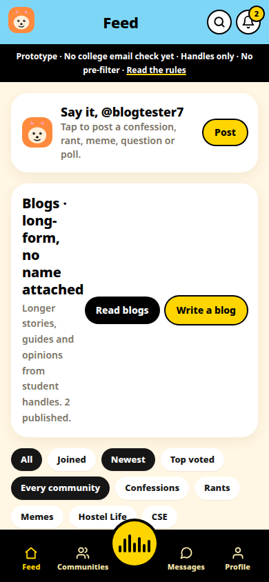
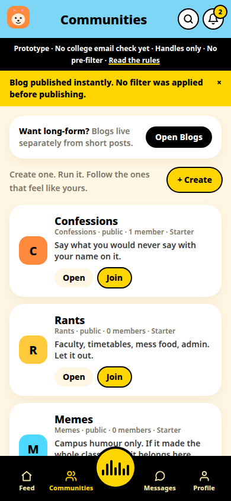
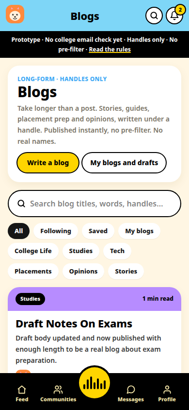

# AnonAdda — A student community with no real names

AnonAdda is a pseudonymous student community prototype. Your identity is a handle you choose, never your real name.

## What it does

- Starter communities like Confessions, Hostel Life, Exams and Viva, Placements, and Lost and Found, with posts, polls, votes, and comments.
- Longer blogs written under a handle, with a custom avatar studio for handle-only profiles.
- Private messages only after a request is accepted by the other side.
- Reporting and blocking built in from the first version.
- An invite-only Premium Club with no payment.

## Status

Working prototype, built November 2026. No real email verification. It starts empty: no seeded users, posts, or messages.

## Showcase only

This repository is a showcase. It contains no source code and no build files, and nothing here is open source. The screenshot(s) above are showcase images only. See NOTICE.md.

## Contact

Built by Yash Dashrath, Pune, India.

- Email: yashdashrath18@gmail.com
- LinkedIn: https://www.linkedin.com/in/yash-dashrath
- Yash MediaWorks: https://www.linkedin.com/company/yashmediaworks/
